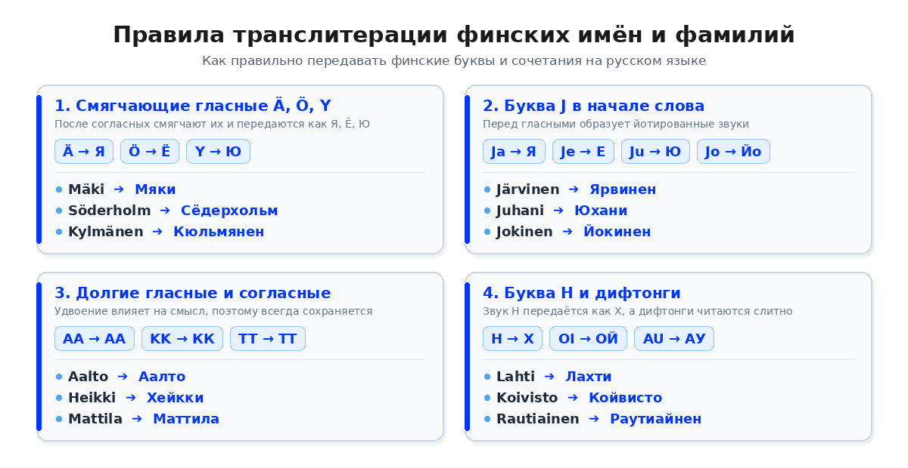
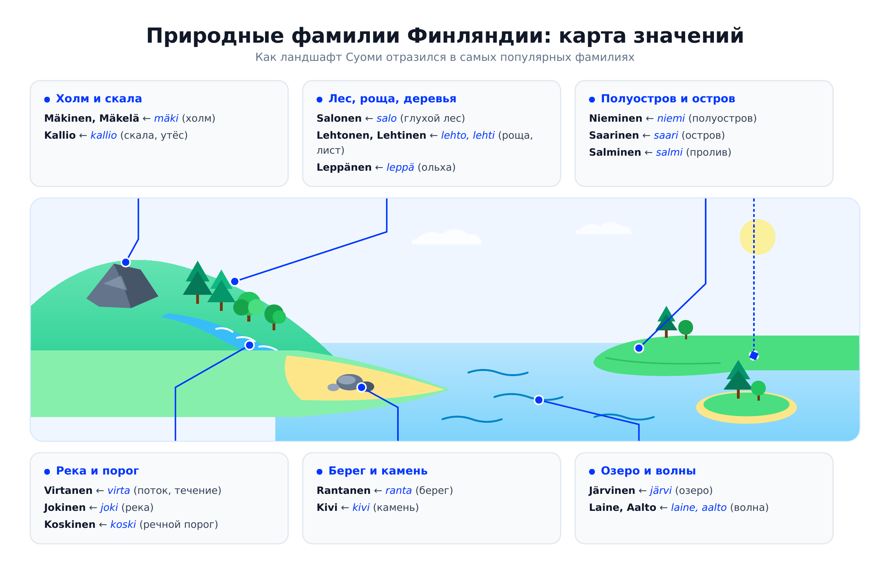

---

Для официальных документов критически важно, чтобы имена, фамилии и названия организаций во всех бумагах передавались единообразно. По общепринятым правилам имена собственные с иностранного языка **не переводят, а транслитерируют** — то есть записывают буквами русского алфавита с сохранением звучания.

Однако финский язык таит в себе немало ловушек для переводчика: от особых гласных до «говорящих» фамилий и названий компаний, за которыми скрываются целые истории.

## Главные правила финской транслитерации

Чтобы в документах (свидетельствах о рождении, дипломах, договорах) не возникало разночтений, при передаче финских имен на русский язык опираются на четкие фонетические правила:

* **Гласные Ä, Ö, Y.** После согласных они смягчают их и передаются как **я, ё, ю**: *Mäki → Мяки*, *Söderholm → Сёдерхольм*, *Kylmänen → Кюльмянен*. В начале слова или после другой гласной *ä* и *ö* часто передаются как **э** и **о/э**: *Äänekoski → Ээнекоски*, *Österman → Эстерман*.
* **Дифтонг YÖ и звук J.** В начале слова перед гласными сочетание *ja, je, jo, ju* превращается в русские йотированные буквы **я, е, ё, ю**: *Järvinen → Ярвинен*, *Joki → Йоки*, *Juhani → Юхани*.
* **Двойные согласные и гласные.** В финском языке долгота звука меняет смысл слова, поэтому на письме удвоение всегда сохраняется: *Mattila → Маттила*, *Aalto → Аалто*, *Koskinen → Коскинен* (но *Koivisto → Койвисто*).
* **Буква H.** Передается через русскую **х**, а не *г*: *Heikki → Хейкки*, *Lahti → Лахти*.

## Названия финских фирм: когда переводят, а когда нет?

В юридических и деловых документах названия компаний (Oy, Ab, Oyj) **никогда не переводятся** по смыслу — они пишутся либо латиницей в оригинале, либо транслитерируются кириллицей.

* **Nokia** — транслитерируется как «Нокиа» (названа в честь реки Нокианвирта, слово *nokia* в старину означало соболя или куницу).
* **Fazer** — читается и пишется по-русски как «Фацер» (по фамилии основателя Карла Фацера, швейцарского происхождения).
* **Valio** — «Валио» (в переводе с финского — «элитный», «отборный»).
* **Kone** — «Коне» (буквально переводится как «машина», «механизм»).
* **Outokumpu** — «Оутокумпу» (название города и месторождения, которое буквально переводится как «странный холм»).
* **Sampo** — «Сампо» (волшебная мельница из карело-финского эпоса «Калевала», приносящая богатство и счастье).

> **Важно для документов:** Если в загранпаспорте или визе имя уже записано латиницей по международным стандартам (например, *Mikhail* вместо *Mihail*), при обратном переводе на русский нужно сверяться с российскими документами, чтобы не создать человеку «нового» однофамильца.

## О чем «говорят» самые популярные финские фамилии

В Финляндии исторически сложилось так, что многие фамилии связаны с природой, ландшафтом или хутором, где жила семья. В XIX веке, во время подъема национального самосознания, тысячи финнов даже меняли свои шведские фамилии на финские «природные».

Ниже приведен расширенный список самых распространенных финских фамилий с их буквальным значением:

* **Korhonen** (Корхонен) — *Глухов* ← от *korho* (глуховатый, тугоухий; самая частая фамилия в Финляндии).
* **Virtanen** (Виртанен) — *Речкин, Ручейкин* (живущий у реки) ← от *virta* (течение, поток, река).
* **Mäkinen** (Мякинен) — *Холмов, Холмогоров* (живущий на холме) ← от *mäki* (гора, пригорок, холм).
* **Nieminen** (Ниеминен) — *Полуостровский* (живущий на полуострове) ← от *niemi* (полуостров).
* **Mäkelä** (Мякеля) — *Холмов, Холмогоров* (суффикс *-lä* указывает на место/усадьбу на холме) ← от *mäki* (холм).
* **Hämäläinen** (Хямяляйнен) — *Тавастландский* (житель исторической провинции Хяме) ← от *Häme*.
* **Laine** (Лайне) — *Волнов* ← от *laine* (волна).
* **Heikkinen** (Хейккинен) — *Генрихов* (патроним от мужского имени *Heikki*).
* **Koskinen** (Коскинен) — *Порогов* (живущий у речного порога) ← от *koski* (порог, водопад).
* **Järvinen** (Ярвинен) — *Озеров* ← от *järvi* (озеро).
* **Lehtonen** (Лехтонен) — *Рощин* ← от *lehto* (роща, лиственный лес).
* **Lehtinen** (Лехтинен) — *Листов, Листочкин* ← от *lehti* (лист).
* **Saarinen** (Сааринен) — *Островский* ← от *saari* (остров).
* **Salminen** (Салминен) — *Проливов* ← от *salmi* (пролив).
* **Heinonen** (Хейнонен) — *Сенов, Травин* ← от *heinä* (сено, трава).
* **Salonen** (Салонен) — *Чащин* ← от *salo* (чаща, глухой лес).
* **Turunen** (Турунен) — *Рыночный* или *Туркуский* ← от древнего слова *turu* (рынок, площадь).
* **Karjalainen** (Карьялайнен) — *Карельский* ← от *karjala* (Карелия).
* **Jokinen** (Йокинен) — *Речкин, Ручьев* ← от *joki* (река).
* **Rantanen** (Рантанен) — *Берегов* ← от *ranta* (берег).
* **Leppänen** (Леппянен) — *Ольхов* ← от *leppä* (ольха).
* **Kallio** (Каллио) — *Скалов, Утесов* ← от *kallio* (скала).
* **Aalto** (Аалто) — *Волнов* ← от *aalto* (высокая волна, вал).
* **Kivi** (Киви) — *Камень* ← от *kivi* (камень).
