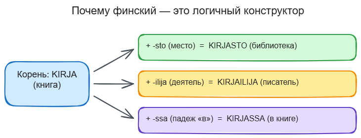

---
О языках рассказывают разные занимательные истории, в том числе откровенные небылицы. Недавно я услышал от одного финна мнение, что финский язык невероятно сложен, а потому люди, владеющие им, якобы намного умнее носителей других языков — в отличие от приезжих, которым он дается с трудом.

Разумеется, никакого научного обоснования у таких заявлений нет — это обычные предрассудки. С точки зрения лингвистики все естественные языки одинаково «легкие» или «сложные», но у каждого своя архитектура. На субъективное ощущение сложности влияет близость вашего родного языка к изучаемому: носителю эстонского или карельского структура финского покажется прозрачной с первых уроков.

А как обстоят дела для русскоязычных учеников? На самом деле у нас есть серьезная фора, просто о ней редко рассказывают в самом начале обучения.

---

### Миф 1. «В финском 15 падежей — это невозможно запомнить»

Пугающая цифра «15 падежей» обычно становится главным аргументом тех, кто боится браться за учебники. Но если посмотреть на финскую грамматику глазами переводчика, выясняется, что **большинство этих падежей — просто привычные нам предлоги**, которые приклеились к концу слова.

Сравните сами:
* **В** доме — *talo**ssa***
* **Из** дома — *talo**sta***
* **В** дом (внутрь) — *talo**on***
* **На** столе — *pöydä**llä***
* **Со** стола — *pöydä**ltä***

В русском языке вы тоже меняете окончания слов после предлогов (*в дом**е***, *из дом**а***, *к дом**у***). В финском вам не нужно запоминать, какой предлог с каким падежом сочетается — само окончание уже несет в себе значение предлога.

---

### Миф 2. «Нужно учить тысячи непохожих слов»

В финском действительно мало привычных интернационализмов вроде *телефон* или *компьютер* (вместо них используются свои слова — *puhelin* и *tietokone*). Однако у этой особенности есть огромный плюс: **финский работает как прозрачный конструктор лего**.

Зная всего один корень и пару суффиксов, вы начинаете понимать десятки новых слов без словаря:

* **kirja** — книга
* **kirja** + *sto* (место) = **kirjasto** — библиотека
* **kirja** + *ilija* (деятель) = **kirjailija** — писатель
* **kirjoittaa** — писать
* **kirje** — письмо

Точно так же устроены и многие другие слова: *puhe* (речь) превращается в *puhelin* (телефон), а *tieto* (знание) + *kone* (машина) дают *tietokone* (компьютер).

---

### В чем главная реальная трудность (и как её обойти)

Сложность финского кроется не в падежах и не в длинных словах. По опыту преподавания могу выделить три вещи, о которые чаще всего спотыкаются новички:

1. **Фонетика и долгота звуков.** В финском слова читаются ровно так, как пишутся — без сложных правил орфографии, как в английском или французском. Но критически важно различать долгие и краткие звуки: *tuli* (огонь), *tuuli* (ветер) и *tulli* (таможня) — три совершенно разных слова.
2. **Разрыв между учебником и улицей.** На курсах учат литературный язык (*kirjakieli*), а финны в жизни говорят на разговорном (*puhekieli*). Вместо *minä olen* вы услышите *mä oon*, а вместо *kaksi* — *kaks*. У ученика возникает ощущение, что он учит «не тот» язык. Это временно, по мере роста знаний понимание разговорного языка приходит само, а вот если учить разговорный язык, то грамматически правильно сказать или написать не получится... Так что, учим литературный.
3. **Непривычный порядок слов в длинных конструкциях.** В русском языке мы сначала называем предмет, а потом поясняем его с помощью слова «который». Финны же собирают всё описание *перед* главным словом, как длинный паровоз. Например: *«**eilen Helsingissä järjestettyyn kokoukseen** osallistuneet ihmiset»*. Если переводить дословно слева направо, получится: «вчера в Хельсинки организованном на собрании участвовавшие люди». А по-русски это звучит так: «люди, которые участвовали в собрании, организованном вчера в Хельсинки». Пока не дочитаешь до самого конца, не поймешь, о ком вообще идет речь.

---

### Итог: так сложный он или нет?

Точно измерить степень сложности языка невозможно, потому что у каждого человека свое восприятие и свои цели. Финский не прощает хаотичной зубрежки отдельных фраз, но очень быстро поддается тем, кто понимает его систему. 

Когда вы видите логику чередования ступеней согласных (KPT), понимаете принцип работы суффиксов и слышите правильный разговорный язык, грамматика перестает быть препятствием и превращается в надежный инструмент.

Если вы пробовали учить финский самостоятельно, но запутались в падежах или перестали понимать живую речь носителей — приходите на вводное занятие. Мы разберем ваши текущие пробелы и выстроим понятную систему обучения под ваши задачи.
