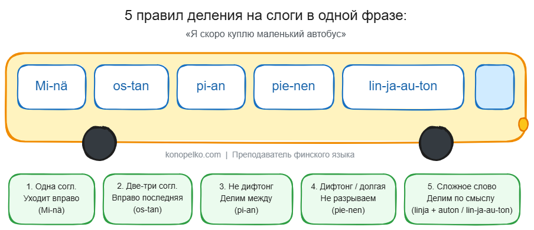

---

В первой главе учебника *Suomen mestari 1* теме деления на слоги (*tavutus*) уделяют буквально полстраницы. Взрослые студенты обычно пролистывают этот блок с мыслью: *«Зачем мне делить слова по слогам, я же не в первом классе?»*

Но в финском языке умение видеть границы слогов — это основа грамотного письма и речи. Именно от того, открыт слог или закрыт, зависит чередование согласных (_KPT_) при изменении слов по падежам и при спряжении глаголов. Если вы не видите границы слогов, то правила чередования *KPT* превращаются в гадание на ромашке...

Чтобы безошибочно определять тип слога, нужно сделать два простых шага: разобраться в базовых «кирпичиках», из которых строятся слова (гласные, согласные и дифтонги), а затем запомнить **одну фразу-подсказку**.

---

### Шаг 1. База: гласные, согласные, дифтонги и два вида слогов

Слог — это минимальный кусочек слова, в котором обязательно есть гласный звук. В зависимости от того, на какую букву заканчивается этот кусочек, финские слоги делятся на два вида:

1. **Открытый слог** — заканчивается на **гласную** букву (*ta-lo*, *ka-tu*).
2. **Закрытый слог** — заканчивается на **согласную** букву (*ta-lon*, *ka-dul-la*).

Чтобы не ошибиться с границей слога, важно чётко различать три группы звуков:

* **Гласные (8 букв):** `a, e, i, o, u, y, ä, ö`.
* **Согласные:** все остальные буквы алфавита.
* **Дифтонги (неразрывные пары гласных):** учить все 18 пар наизусть не нужно. Дифтонги почти всегда заканчиваются на **`-i`**, **`-u`** или **`-y`** (*ai, ei, oi, ui, au, ou, äy...*) плюс три «перевёртыша» (**`ie, uo, yö`**). Остальные сочетания гласных (*ia, ua, ea, oa*) — это не дифтонги, и при делении на слоги они разрываются.

---

### Шаг 2. Главное правило и 1 мнемоническая фраза

Теперь, когда вы знаете разницу между гласными, согласными и дифтонгами, можно переходить к самому делению. В финском языке работает один базовый принцип: **каждый новый слог стремится начинаться с одной согласной буквы**.

Чтобы не заучивать сухие формулировки, запомните всего одно простое финское предложение с правильным порядком слов и ярким образом — в нём собраны **все 5 возможных случаев деления на слоги**:

> **Mi-nä os-tan pi-an pie-nen lin-ja-au-ton.** *Перевод: «Я скоро куплю маленький автобус».*

| Фраза                    | Что видим в слове                                                            | Простое правило                                                                        |
| :----------------------- | :--------------------------------------------------------------------------- | :------------------------------------------------------------------------------------- |
| **1. Mi-nä**          | Между гласными стоит **одна** согласная.                                     | Отдаём эту согласную в новый слог (вправо).                                            |
| **2. os-tan**         | Подряд идут **две или три** согласные.                                       | В новый слог уходит только **последняя** согласная.                                    |
| **3. pi-an**          | Рядом стоят две разные гласные, но **не дифтонг** (`ia, ua, ea, oa`).        | Ставим черту **прямо между** этими гласными.                                           |
| **4. pie-nen**        | Рядом стоят **дифтонг** (`ie, uo, ai...`) или **долгая гласная** (`aa, ii`). | Долгую гласную и дифтонг **не разрываем**.                                             |
| **5. lin-ja-au-ton**  | **Сложное слово** из двух основ или заимствование.                           | Сначала делим по смыслу (*linja* + *auton*). В заимствованиях `kr, tr, pr` не делятся. |

---

### Проверочный тест: закрепите все 5 случаев на похожих примерах

Попробуйте самостоятельно разделить слева направо эти 5 групп слов (по три слова на каждый случай из фразы про автобус):

1. **koti, talo, katu** 
2. **pankki, kauppa, kortti** 
3. **lukea, asia, haluan** 
4. **pöytä, tuoli, kiitos** 
5. **tietokone, linja-auto, stressi** 

<strong>Нажмите, чтобы проверить ответы</strong>

1. **ko-ti, ta-lo, ka-tu** — как *mi-nä* (одна согласная между гласными уходит вправо).
2. **pank-ki, kaup-pa, kort-ti** — как *os-tan* (из нескольких согласных вправо уходит только самая последняя).
3. **lu-ke-a, a-si-a, ha-lu-an** — как *pi-an* (сочетания `ea`, `ia`, `ua` не являются дифтонгами, поэтому делятся).
4. **pöy-tä, tuo-li, kii-tos** — как *pie-nen* (дифтонги `öy`, `uo` и долгая гласная `ii` не разрываются).
5. **tie-to-ko-ne, lin-ja-au-to, stres-si** — как *lin-ja-au-ton* (сложные слова делятся по границе основ, а в заимствованиях сочетание `tr` не делится).

---

### Хотите разложить финскую грамматику по полочкам без зубрёжки?

На индивидуальных занятиях я объясняю логику *Suomen mestari* простым и понятным языком — мы не заучиваем бесконечные таблицы, а учимся видеть структуру языка и сразу применяем правила в живой речи.
