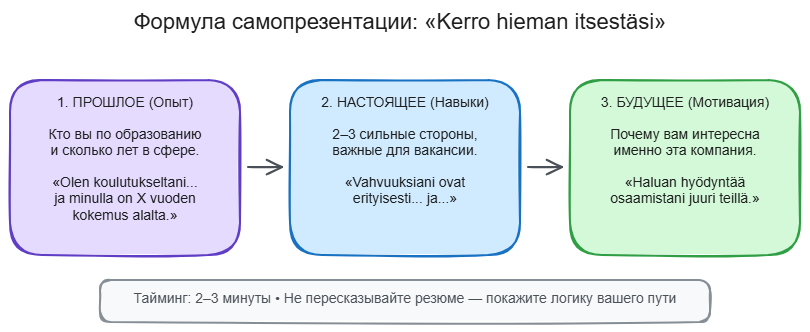
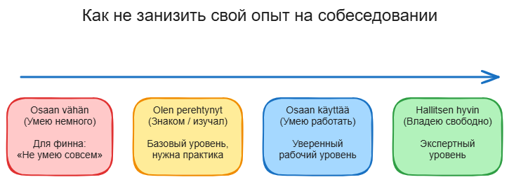

---

Поиск работы в Финляндии — это не только соревнование резюме, но и проверка того, насколько легко вам будет вписаться в рабочее сообщество (*työyhteisö*). Приглашение на интервью (*työhaastattelu*) часто вызывает стресс: кажется, что словарного запаса не хватит, а любая грамматическая ошибка перечеркнет шансы.

Как преподаватель и переводчик, я часто помогаю ученикам готовиться к интервью. Хорошая новость в том, что финские работодатели не ждут от иностранца идеального владения падежами. Они оценивают мотивацию, честность и умение ясно доносить свою мысль. 

Ниже — пошаговый план подготовки и конкретные языковые конструкции, которые помогут вам звучать профессионально.

---

### 1. Самопрезентация по формуле «Прошлое — Настоящее — Будущее»

В начале встречи рекрутер почти всегда просит рассказать о себе (*Kerro hieman itsestäsi*). Главная ошибка кандидатов — начинать пересказывать резюме с момента окончания школы. Финны ценят структуру и уважают чужое время, поэтому ваш рассказ должен занимать **не более 2–3 минут**.

Используйте эти фразы-связки, чтобы выстроить логичный рассказ:

* **Начало и опыт:** *«Olen koulutukseltani [например: insinööri / sairaanhoitaja], ja minulla on [X] vuoden kokemus alalta.»* (По образованию я..., и у меня Х лет опыта в этой сфере).
* **Ключевые навыки:** *«Vahvuuksiani ovat erityisesti [навык 1] ja [навык 2].»* (Моими сильными сторонами являются, в частности, ... и ...).
* **Мотивация:** *«Hain tätä paikkaa, koska yrityksenne [чем занимается компания] kiinnostaa minua todella paljon, ja haluan hyödyntää osaamistani juuri teillä.»* (Я подал заявку на эту вакансию, так как деятельность вашей компании мне очень интересна, и я хочу применить свои навыки именно у вас).

Выучите этот блок наизусть и отработайте на диктофон. Уверенное начало снимет стартовое волнение и задаст правильный темп всей беседе.

---

### 2. Ловушки перевода: как не обесценить свой опыт

В финской деловой культуре не принято хвастаться. Однако русскоязычные кандидаты часто впадают в другую крайность — из вежливости занижают свои навыки. Проблема в том, что финны воспринимают слова буквально.

Если вы скажете: *«Osaan vähän käyttää Exceliä»* (Я немного умею пользоваться Excel), рекрутер сделает пометку: «Программой не владеет, придется учить с нуля». «Не хвастаться — не значит обесценивать. Финн ценит точность: если умеете — скажите “osaan”, если нет — “en osaa”.»

Запомните разницу между глаголами, описывающими ваши компетенции:

* **Olen perehtynyt [чему-то в иллативе — mihin?]** — «Я знаю тему, разбираюсь» (например: *Olen perehtynyt uuteen ohjelmistoon*). Подходит для навыков, которыми вы владеете на базовом уровне.
* **Osaan [что-то в партитиве или инфинитив]** — «Я умею это делать уверенно». Нейтральный и надежный глагол для рабочих задач.
* **Hallitsen [что-то + генитив/партитив]** — «Я владею этим свободно, на уровне эксперта» (например: *Hallitsen hyvin projektinhallinnan*). Используйте для своих главных профессиональных инструментов.

Вместо общих слов о своей эффективности приводите один конкретный факт: *«Vastasin projektista, jonka ansiosta tiimin työ nopeutui huomattavasti»* (Я отвечал за проект, благодаря которому работа команды заметно ускорилась).

---

### 3. Перевод с русского менталитета: 3 частых вопроса

Дословный перевод привычных нам ответов на собеседовании может прозвучать для финна неискренне или слишком агрессивно. Сравните неудачные кальки и рабочие варианты:

| Вопрос рекрутера | Как часто отвечают (ошибка) | Как лучше ответить по-фински |
| :--- | :--- | :--- |
| **Mitkä ovat heikkoutesi?** *(Какие у вас слабые стороны?)* | *«Olen perfektionisti ja teen liikaa töitä.»* (Я перфекционист и слишком много работаю — звучит как заученное клише). | *«Joskus keskityn liikaa yksityiskohtiin, mutta olen oppinut aikatauluttamaan työni paremmin.»* (Иногда я слишком фокусируюсь на деталях, но я научился лучше планировать время). |
| **Mikä on palkkatoiveesi?** *(Какие у вас зарплатные ожидания?)* | *«En tiedä, mitä tarjoatte?»* (Не знаю, а сколько предложите? — показывает неуверенность). | *«Palkkatoiveeni on [X] euroa kuukaudessa, mutta olen avoin keskustelemaan kokonaisuudesta.»* (Мои ожидания — Х евро в месяц, но я открыт к обсуждению условий в целом). |
| **Miksi meidän pitäisi valita juuri sinut?** *(Почему мы должны выбрать именно вас?)* | *«Olen parempi kuin muut hakijat.»* (Я лучше других кандидатов — нарушение этики, нельзя сравнивать себя с другими). | *«Uskon, että kokemukseni [сфера] ja nopea oppimiskykyni auttavat minua pääsemään nopeasti kiinni työhön.»* (Верю, что мой опыт и способность быстро учиться помогут мне быстро включиться в работу). |

---

### 4. Как реагировать, если вы не поняли вопрос (и что спросить самому)

На интервью на неродном языке абсолютно нормально не расслышать слово или не понять длинный вопрос. Самая большая ошибка — кивать с умным видом и отвечать наугад. В финской рабочей культуре умение вовремя уточнить задачу ценится гораздо выше, чем попытка скрыть непонимание.

Держите под рукой три вежливые фразы-спасатели:

* **Если нужно переспросить:** *«Anteeksi, en ihan kuullut. Voisitko toistaa kysymyksen?»* (Извините, я не совсем расслышал. Не могли бы вы повторить вопрос?)
* **Если вопрос слишком сложный:** *«Voisitko muotoilla kysymyksen hieman toisin?»* (Не могли бы вы сформулировать вопрос немного иначе?)
* **Чтобы проверить, правильно ли вы поняли суть:** *«Tarkoititko, että...»* (Вы имели в виду, что...) или *«Ymmärsinkö oikein, että kysyt...»* (Правильно ли я понял, что вы спрашиваете...).

Пока рекрутер переформулирует вопрос, у вас появятся лишние 10–15 секунд, чтобы успокоиться и подобрать нужные слова.

#### Что спросить у работодателя в конце встречи
В финале собеседования рекрутер обязательно спросит: *«Onko sinulla kysyttävää meille?»* (Есть ли у вас вопросы к нам?). Ответ «Нет, всё понятно» часто считывается как отсутствие интереса. Задайте один-два уточняющих вопроса:

* *«Millainen on tyypillinen työpäivä tässä tehtävässä?»* (Как выглядит типичный рабочий день на этой должности?)
* *«Millainen tiimi tässä projektissa työskentelee?»* (Какая команда работает над этим проектом?)
* *«Milloin voin odottaa tietoa jatkosta?»* (Когда можно ожидать информацию о следующих этапах?)

---

### Как закрепить подготовку на практике

Прочитать список фраз полезно, но на реальном собеседовании включается стресс, и знакомые слова вылетают из головы. Самый надежный способ подготовиться — прорепетировать интервью вслух до встречи с работодателем.

На индивидуальных занятиях мы можем провести **пробное собеседование под вашу конкретную вакансию**: составим и отшлифуем вашу самопрезентацию, уберем кальки с русского языка и потренируемся отвечать на неудобные вопросы рекрутера в спокойной обстановке. 

Если у вас скоро интервью и нужна помощь с подготовкой — напишите мне через раздел «Контакты», и мы подберем удобное время.
