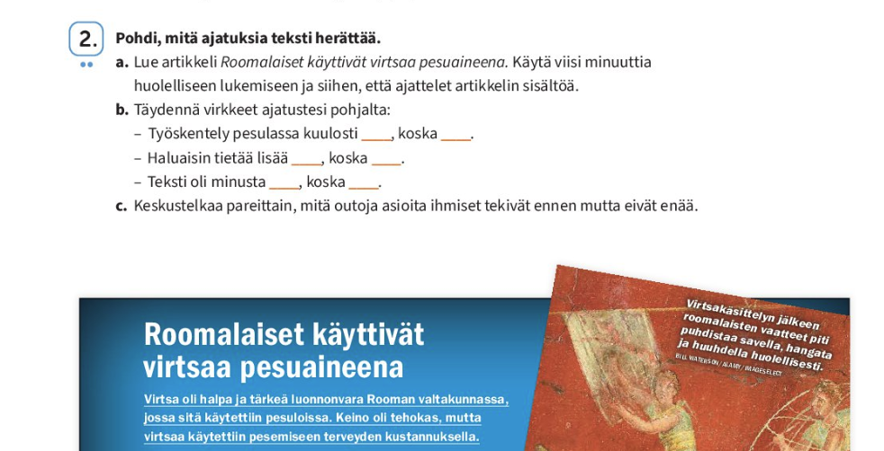
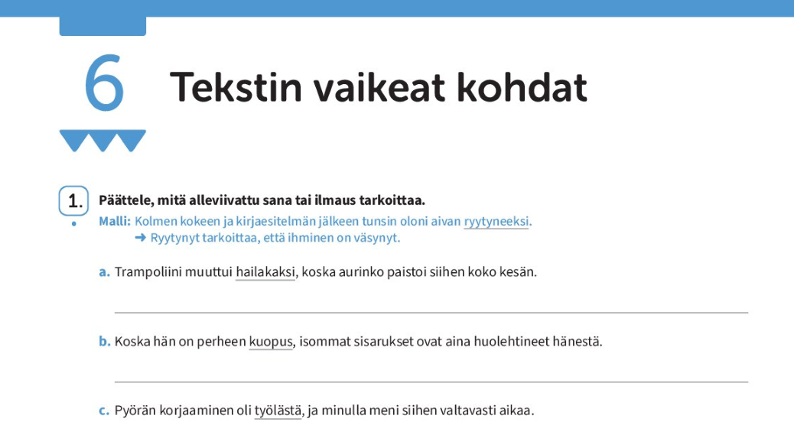
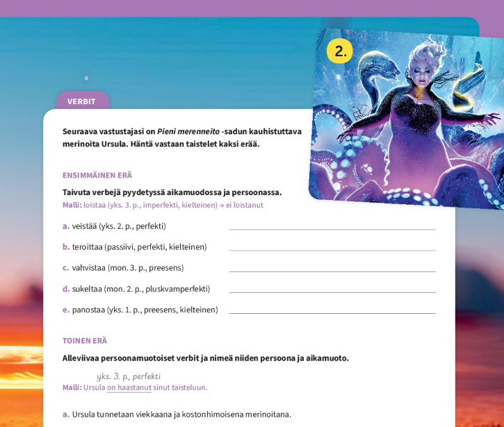

Когда семья переезжает в Финляндию, одной из главных задач становится интеграция ребенка ---
title: 'Адаптация в финской школе: почему ребенок молчит на уроках и как ему помочь'
description: 'Разбор психологических и языковых трудностей русскоязычных детей в школах Финляндии. Практические советы для родителей.'
order: 2
category: 'learning'
lang: 'ru'
---

Когда семья переезжает в Финляндию, одной из главных задач становится интеграция ребенка в местную систему образования. Первое время родители радуются: в финских школах нет привычного стресса, оценок в первые годы учебы и огромных домашних заданий. 

Однако через полгода может выясниться, что ребенок ушел в себя, почти не общается с одноклассниками и молчит, когда учитель вызывает его к доске. При этом дома он может уверять, что «всё нормально».

Давайте разберем причины этого защитного барьера и конкретные шаги, которые помогут ребенку его преодолеть без потери самооценки.

---

### ✦ Проблема: Страх совершить ошибку (Синдром отличника)

В русскоязычной культуре образования ошибка часто воспринимается как провал. Подросток боится перепутать падеж или окончание глагола, поэтому выбирает стратегию «лучше промолчать, чем показаться смешным». В итоге он теряет необходимую речевую практику.

### ✓ Как помочь: Перевод фокуса с оценки на коммуникацию

Объясните ребенку базовое правило финского менталитета: финны очень терпимы к ошибкам иностранцев, для них важен сам смысл сообщения, а не идеальная грамматика. Иногда небольшая доля здорового пофигизма здорово помогает в общении :) Главное, чтобы тебя поняли.

* **Показывайте личный пример:** Если вы сами учите финский и ошиблись в магазине или на курсах, расскажите об этом ребенку с улыбкой: *«Я сегодня перепутал слова, но меня всё равно поняли»*.
* **Проверяйте слова вместе:** Если возник спорный момент, загляните вместе в Википедию или *Kielitoimiston sanakirja* или предложите ребенку уточнить фразу у школьного учителя.
* **Выучите дома фразы**, которые помогут не впадать в ступор на уроке: 
  -  *«Voisitko toistaa, kiitos?»* (Не могли бы вы повторить, пожалуйста?)
  - *«Voisitko selittää tämän toisin?»* (Не могли бы вы объяснить это другими словами?)
  - *«Hetkinen, mietin vähän...»* (Минуточку, я немного подумаю...)
  - *«Hyvä kysymys, hetkinen...»* (Хороший вопрос, секундочку...)
  - *«En ole vielä varma, mutta mielestäni...»* (Я пока не уверен, но по-моему...)
* **Хвалите за смелость:** Отмечайте любую попытку высказать мысль на финском, даже если в ней были грамматические неточности.

---

### ✦ Проблема: Разница в культуре общения

Финские дети с детства привыкли к соблюдению личных границ и тишине. Они редко проявляют инициативу в знакомстве первыми. Наш подросток может принять это за холодность или нежелание общаться, чувствуя себя отвергнутым.

### ✓ Как помочь: Интеграция через общие интересы

В Финляндии дружба и общение строятся вокруг совместной деятельности.

* **Найдите секцию по интересам**: бассейн, кружок рисования или клуб робототехники. 
* В неформальной обстановке, где фокус смещен на игру или хобби, языковой барьер падает быстрее. 

---

### ✦ Проблема: Отсутствие навыка аргументации

Финская школа практически не требует механического зазубривания параграфов. На уроках истории или обществознания (*yhteiskuntaoppi*) от ученика постоянно ждут личной позиции.

◇ Взгляните на задание из финского учебника *Valtti 7* для 7 класса:

После небольшого текста ученику предлагают:
* *«Pohdi, mitä ajatuksia teksti herättää»* — подумать, какие мысли вызывает прочитанное.
* Закончить фразы со словом *koska* (потому что), самостоятельно обосновав свое впечатление (*«Työskentely pesulassa kuulosti _____, koska _____.»*).
* Обсудить тему в паре с одноклассником (*«Keskustelkaa pareittain...»*).

В учебнике готового «правильного» ответа нет, и подросток, непривычный к такому формату, теряется и молчит.

### ✓ Как помочь: Тренировка аргументации на родном языке

Этот навык нужно сначала сформировать в комфортной домашней среде.

* **Обсуждайте повседневные темы:** Во время ужина или прогулки чаще задавайте ребенку открытые вопросы: *«Почему герой фильма так поступил?»*, *«Как бы ты решил эту ситуацию?»*.
* **Научите формуле «Тезис + 2 аргумента»**: Попросите ребенка не просто сказать «мне понравилось» или «это несправедливо», а привести две-три причины на русском языке. Потом эту логику ему будет проще перенести на финский язык и использовать в классе.

---

### ✦ Проблема: Привычка переводить каждое слово со словарем

Когда русскоязычный школьник открывает финский параграф по биологии или истории и видит десяток незнакомых слов, у него начинается паника: *«Я ничего не понимаю, я не смогу ответить»*. Привычка опираться на дословный перевод в финской школе только тормозит ученика.

◇ Посмотрите на упражнение из того же учебника *Valtti 7*:

Ученику дают предложения с редкими или сложными словами (*ryytyneeksi*, *hailakaksi*, *työlästä*, *saivarrella*) и просят:
* *«Päättele, mitä alleviivattu sana tai ilmaus tarkoittaa»* — **догадаться по контексту**, что означает подчеркнутое слово.
* Объяснить его значение своими словами на финском, а не искать перевод.

### ✓ Как помочь: Развивайте «языковую интуицию»

Объясните ребенку, что понимать 60–70% текста — это уже отличный результат. 

* **Играйте в «детектива»:** Читайте вместе небольшие заметки на простом финском (например, на *Yle Selkouutiset*). Когда встретится незнакомое слово, не лезьте сразу в переводчик — попробуйте вместе угадать его смысл по соседним словам.
* **Учите объяснять «вокруг да около»:** Если ребенок забыл слово на уроке, пусть опишет его простыми фразами (например, вместо «парикмахер» сказать *«ihminen, joka leikkaa hiuksia»* — человек, который стрижет волосы). В финской школе такой навык ценится очень высоко.

---

### Зачем вообще знать, как устроены финские учебники?

Как видите, трудности в финской школе редко связаны только со знанием правил. Гораздо чаще ребенку не хватает привычки рассуждать, угадывать смысл по контексту и не бояться говорить с акцентом.

Даже обычную грамматику в местных учебниках превращают в квест — например, предлагают «сразиться» с морской ведьмой Урсулой из «Русалочки», отбиваясь правильными формами финских глаголов:

Именно по таким живым, аутентичным материалам я строю свои занятия. Мы не просто зубрим падежи, а учимся думать на финском, понимать логику школьных заданий и смело высказывать свое мнение — чтобы ваш ребенок чувствовал себя на уроках уверенно и спокойно.
в местную систему образования. Первое время родители радуются: в финских школах нет привычного стресса, оценок в первые годы учебы и огромных домашних заданий.

Однако через полгода может выясниться, что ребенок ушел в себя, почти не общается с одноклассниками и молчит, когда учитель вызывает его к доске. При этом дома он может уверять, что «всё нормально».

Давайте разберем причины этого защитного барьера и конкретные шаги, которые помогут ребенку его преодолеть без потери самооценки.

---

✦ Проблема: Страх совершить ошибку (Синдром отличника)

В русскоязычной культуре образования ошибка часто воспринимается как провал. Подросток боится перепутать падеж или окончание глагола, поэтому выбирает стратегию «лучше промолчать, чем показаться смешным». В итоге он теряет необходимую речевую практику.

✓ Как помочь: Перевод фокуса с оценки на коммуникацию

Объясните ребенку базовое правило финского менталитета: финны очень терпимы к ошибкам иностранцев, для них важен сам смысл сообщения, а не идеальная грамматика. Иногда небольшая доля здорового пофигизма здорово помогает в общении :) Главное, чтобы тебя поняли.

- **Показывайте личный пример:** Если вы сами учите финский и ошиблись в магазине или на курсах, расскажите об этом ребенку с улыбкой: _«Я сегодня перепутал слова, но меня всё равно поняли»_.
- **Проверяйте слова вместе:** Если возник спорный момент, загляните вместе в Википедию или _Kielitoimiston sanakirja_ или предложите ребенку уточнить фразу у школьного учителя.
- **Выучите дома фразы**, которые помогут не впадать в ступор на уроке:
    - _«Voisitko toistaa, kiitos?»_ (Не могли бы вы повторить, пожалуйста?)
    - _«Voisitko selittää tämän toisin?»_ (Не могли бы вы объяснить это другими словами?)
    - _«Hetkinen, mietin vähän...»_ (Минуточку, я немного подумаю...)
    - _«Hyvä kysymys, hetkinen...»_ (Хороший вопрос, секундочку...)
    - _«En ole vielä varma, mutta mielestäni...»_ (Я пока не уверен, но по-моему...)
- **Хвалите за смелость:** Отмечайте любую попытку высказать мысль на финском, даже если в ней были грамматические неточности.

---

✦ Проблема: Разница в культуре общения

Финские дети с детства привыкли к соблюдению личных границ и тишине. Они редко проявляют инициативу в знакомстве первыми. Наш подросток может принять это за холодность или нежелание общаться, чувствуя себя отвергнутым.

✓ Как помочь: Интеграция через общие интересы

В Финляндии дружба и общение строятся вокруг совместной деятельности.

- **Найдите секцию по интересам**: бассейн, кружок рисования или клуб робототехники.
- В неформальной обстановке, где фокус смещен на игру или хобби, языковой барьер падает быстрее.

---

✦ Проблема: Отсутствие навыка аргументации

Финская школа практически не требует механического зазубривания параграфов. На уроках истории или обществознания (_yhteiskuntaoppi_) от ученика постоянно ждут личной позиции.

◇ Взгляните на задание из финского учебника _Valtti 7_ для 7 класса:

После небольшого текста ученику предлагают:

- _«Pohdi, mitä ajatuksia teksti herättää»_ — подумать, какие мысли вызывает прочитанное.
- Закончить фразы со словом _koska_ (потому что), самостоятельно обосновав свое впечатление (_«Työskentely pesulassa kuulosti _____, koska _____.»_).
- Обсудить тему в паре с одноклассником (_«Keskustelkaa pareittain...»_).

В учебнике готового «правильного» ответа нет, и подросток, непривычный к такому формату, теряется и молчит.

✓ Как помочь: Тренировка аргументации на родном языке

Этот навык нужно сначала сформировать в комфортной домашней среде.

- **Обсуждайте повседневные темы:** Во время ужина или прогулки чаще задавайте ребенку открытые вопросы: _«Почему герой фильма так поступил?»_, _«Как бы ты решил эту ситуацию?»_.
- **Научите формуле «Тезис + 2 аргумента»**: Попросите ребенка не просто сказать «мне понравилось» или «это несправедливо», а привести две-три причины на русском языке. Потом эту логику ему будет проще перенести на финский язык и использовать в классе.

---

✦ Проблема: Привычка переводить каждое слово со словарем

Когда русскоязычный школьник открывает финский параграф по биологии или истории и видит десяток незнакомых слов, у него начинается паника: _«Я ничего не понимаю, я не смогу ответить»_. Привычка опираться на дословный перевод в финской школе только тормозит ученика.

◇ Посмотрите на упражнение из того же учебника _Valtti 7_:

Ученику дают предложения с редкими или сложными словами (_ryytyneeksi_, _hailakaksi_, _työlästä_, _saivarrella_) и просят:

- _«Päättele, mitä alleviivattu sana tai ilmaus tarkoittaa»_ — **догадаться по контексту**, что означает подчеркнутое слово.
- Объяснить его значение своими словами на финском, а не искать перевод.

✓ Как помочь: Развивайте «языковую интуицию»

Объясните ребенку, что понимать 60–70% текста — это уже отличный результат.

- **Играйте в «детектива»:** Читайте вместе небольшие заметки на простом финском (например, на _Yle Selkouutiset_). Когда встретится незнакомое слово, не лезьте сразу в переводчик — попробуйте вместе угадать его смысл по соседним словам.
- **Учите объяснять «вокруг да около»:** Если ребенок забыл слово на уроке, пусть опишет его простыми фразами (например, вместо «парикмахер» сказать _«ihminen, joka leikkaa hiuksia»_ — человек, который стрижет волосы). В финской школе такой навык ценится очень высоко.

---

Зачем вообще знать, как устроены финские учебники?

Как видите, трудности в финской школе редко связаны только со знанием правил. Гораздо чаще ребенку не хватает привычки рассуждать, угадывать смысл по контексту и не бояться говорить с акцентом.

Даже обычную грамматику в местных учебниках превращают в квест — например, предлагают «сразиться» с морской ведьмой Урсулой из «Русалочки», отбиваясь правильными формами финских глаголов:

Именно по таким живым, аутентичным материалам я строю свои занятия. Мы не просто зубрим падежи, а учимся думать на финском, понимать логику школьных заданий и смело высказывать свое мнение — чтобы ваш ребенок чувствовал себя на уроках уверенно и спокойно.