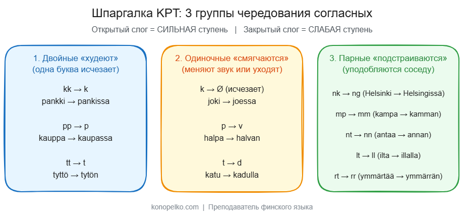

В прошлой статье мы научились делить финские слова на слоги и отличать **открытый слог** (заканчивается на гласную) от **закрытого** (заканчивается на согласную). Теперь применим этот навык на практике — разберём одну из главных тем учебника *Suomen mestari 1*: **чередование ступеней согласных (*KPT-vaihtelu*)**.

На курсах студентам обычно выдают длинную таблицу из 16 строчек и предлагают выучить её наизусть. На деле здесь нет никакого хаоса: все изменения подчиняются строгой логике и делятся всего на **3 простые группы**.

---

### Главное правило: как слог переключает KPT

Чередование затрагивает только три согласные в середине или конце основы слова: **K, P и T** (и их сочетания). Первая буква слова никогда не меняется.

* **Открытый слог** (дверь открыта, звуку просторно) → включается **СИЛЬНАЯ ступень** (*ka-tu*, *pank-ki*).
* **Закрытый слог** (слог закрылся согласной, звуку тесно) → включается **СЛАБАЯ ступень** (*ka-dul-la*, *pan-kis-sa*).

---

### Вся таблица KPT в 3 логических группах

Чтобы не учить 16 случайных пар, разбейте их по принципу действия:

#### Группа 1. Двойные согласные «худеют» (самый частый случай)
Если в сильной ступени стоят две одинаковые согласные, в слабой одна из них просто исчезает:
* **kk → k:** *pankki* (банк) → *pan**k**issa* (в банке)
* **pp → p:** *kauppa* (магазин) → *kau**p**assa* (в магазине)
* **tt → t:** *tyttö* (девочка) → *ty**t**ön* (девочки)

#### Группа 2. Одиночные согласные «смягчаются» (или исчезают)
* **k → исчезает (Ø):** *joki* (река) → *jo**e**ssa* (в реке), *lukea* (читать) → *lu**e**n* (я читаю)
* **p → v:** *halpa* (дешёвый) → *hal**v**an* (дешёвого)
* **t → d:** *katu* (улица) → *ka**d**ulla* (на улице), *tietää* (знать) → *tie**d**än* (я знаю)

#### Группа 3. Парные согласные «подстраиваются» под соседа
Если перед *k, p* или *t* стоят звуки **n, l, r, m**, в слабой ступени вторая буква уподобляется первой:
* **nk → ng:** *Helsinki* → *Helsi**ng**issä* (в Хельсинки)
* **mp → mm:** *kampa* (расчёска) → *ka**mm**an* (расчёски)
* **nt → nn:** *antaa* (давать) → *a**nn**an* (я даю)
* **lt → ll:** *ilta* (вечер) → *i**ll**alla* (вечером)
* **rt → rr:** *ymmärtää* (понимать) → *ymmä**rr**än* (я понимаю)

*(Редкие случаи: **lke → lje**, **rke → rje**, **hke → hje**, а также **uku / yky → uvu / yvy**, например: luku → lu**v**un).*

---

### Главная ловушка: существительные против глаголов

На этом моменте спотыкается 90% учеников. Само правило «открытый слог = сильная, закрытый = слабая» работает **всегда**, но стартовая точка у разных частей речи противоположная:

| Часть речи | Какая начальная форма? | Что происходит при изменении? | Пример (было → стало) |
| :--- | :--- | :--- | :--- |
| **Существительные и прилагательные** | **СИЛЬНАЯ** (последний слог открыт) | Добавляем падежное окончание (`-n`, `-ssa`, `-lla`) → слог **закрывается** → ступень становится **СЛАБОЙ**. | *kau**pp**a* → *kau**p**assa* *ka**t**u* → *ka**d**ulla* |
| **Глаголы 1-го типа** (`-aa / -ää`) | **СИЛЬНАЯ** (*antaa*, *tietää*) | Добавляем личное окончание (`-n`, `-t`, `-mme`) → слог **закрывается** → ступень становится **СЛАБОЙ**. | *a**nt**aa* → *a**nn**an* *tie**t**ää* → *tie**d**än* |
| **Глаголы 3, 4 и 6 типов** (`-la`, `-ta`, `-eta`) | **СЛАБАЯ** (*tavata*, *ajatella*) | При спряжении убираем `-ta / -la` и ставим гласную → слог **открывается** → ступень становится **СИЛЬНОЙ**. | *ta**v**ata* → *ta**p**aan* *aja**t**ella* → *aja**tt**elen* |

**Важное исключение:** падеж **Partitiivi** (окончания *-a / -ä / -ta / -tä*) никогда не меняет ступень существительного — слово остаётся в начальной сильной форме (*kauppa → kauppaa*, *katu → katua*).

---

### Проверочный тест: закрепите шпаргалку за 1 минуту

Поставьте слова в нужную форму, используя схему выше:

1. **kauppa** (магазин) → *в магазине* (`-ssa`)
2. **katu** (улица) → *на улице* (`-lla`)
3. **Helsinki** → *в Хельсинки* (`-ssä`)
4. **tietää** (знать, глагол 1 типа) → *я знаю* (`minä ...`)
5. **tavata** (встречать, глагол 4 типа) → *я встречаю* (`minä ...`)

<strong>Нажмите, чтобы проверить ответы</strong>

1. **kaupassa** — слог закрылся (`kau-pas-sa`), двойная `pp` стала одиночной `p`.
2. **kadulla** — слог закрылся (`ka-dul-la`), `t` смягчилась в `d`.
3. **Helsingissä** — слог закрылся (`Hel-sin-gis-sä`), `nk` перешло в `ng`.
4. **tiedän** — у глагола 1 типа слог закрылся окончанием `-n`, `t` перешла в `d`.
5. **tapaan** — у глагола 4 типа слог открылся (`ta-paan`), слабая `v` усилилась до `p`.

---

### Хотите разложить финскую грамматику по полочкам без зубрёжки?

На индивидуальных занятиях я объясняю логику *Suomen mestari* простым и понятным языком — мы не заучиваем бесконечные таблицы, а учимся видеть структуру языка и сразу применяем правила в живой речи. 👉 Пишите/звоните.
