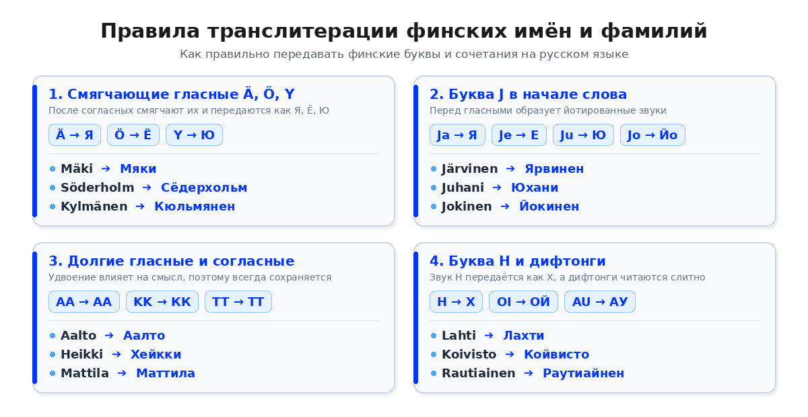

---
Существуют строгие правила практической транскрипции финских слов на русский язык. Однако на практике эти правила знают не все, из-за чего у одного финского города или имени появляется по нескольку искажённых русских вариантов. А когда финские топонимы начинают ещё и склонять по падежам, узнать оригинал становится совсем сложно.

## Три главных правила произношения и записи

Если вы заботитесь не только о красоте звучания, но и о точности смысла, соблюдайте три несложных принципа при использовании финских названий:

1. **Ударение всегда падает на первый слог** — независимо от длины слова и двойных гласных в середине (побочное ударение может падать на третий или пятый слог, но главный ударный всегда первый).
2. **Финские названия читаются ровно так, как пишутся** — двойные гласные и согласные произносятся протяжно, а буква *e* передаётся как русское *«э»* (после согласных — *«е»*).
3. **Финские названия не склоняются и не сокращаются** при официальной или точной передаче (например, правильно говорить *«в городе Лаппеэнранта»*, а не *«в Лаппенранте»*).

## Как передавать сложные финские буквы по-русски

Чтобы в записи имен и топонимов не возникало разночтений, опирайтесь на следующие фонетические соответствия:

* **Гласные Ä, Ö, Y.** После согласных они смягчают их и передаются как **я, ё, ю**: *Mäki → Мяки*, *Söderholm → Сёдерхольм*, *Kylmänen → Кюльмянен*. В начале слова или после другой гласной *ä* и *ö* передаются как **э** и **о/э**: *Äänekoski → Ээнекоски*, *Österman → Эстерман*.
* **Буква J в начале слова и перед гласными.** Сочетания *ja, je, jo, ju* превращаются в русские йотированные буквы **я, е, ё, ю**: *Järvinen → Ярвинен*, *Joki → Йоки*, *Juhani → Юхани*.
* **Двойные согласные и гласные.** В финском языке долгота звука меняет смысл слова, поэтому на письме удвоение всегда сохраняется: *Mattila → Маттила*, *Aalto → Аалто*, *Koskinen → Коскинен* (но *Koivisto → Койвисто*).
* **Буква H.** Передаётся через русскую **х**, а не *г*: *Heikki → Хейкки*, *Lahti → Лахти*.

## Примеры правильной и ошибочной передачи названий

Ниже приведён список городов и регионов Финляндии с правильным написанием и ударением (рядом зачёркнуты частые ошибки, которых стоит избегать):

* **Iisalmi** — **И́йсалми** *(не ~~И́исалми~~, ~~И́салми~~)*
* **Jalasjärvi** — **Я́ласъя́рви** *(не ~~Яласярви~~)*
* **Joutseno** — **Йо́утсено**
* **Jyväskylä** — **Ю̀вяскюля** *(не ~~Ювя̀скюля~~)*
* **Joensuu** — **Йо́энсуу** *(не ~~Йоенсуу~~, ~~Йонсу~~)*
* **Kitee** — **Ки́теэ** *(не ~~Ките~~)*
* **Lappeenranta** — **Ла̀ппеэнранта** *(не ~~Ла̀ппенранта~~, ~~Лапенра̀нта~~)*
* **Pohjanmaa** — **По́хьянмаа** *(или **По́хъянмаа**)*
* **Ylivieska** — **Ю́ливиеска** *(не ~~Юливеска~~)*
